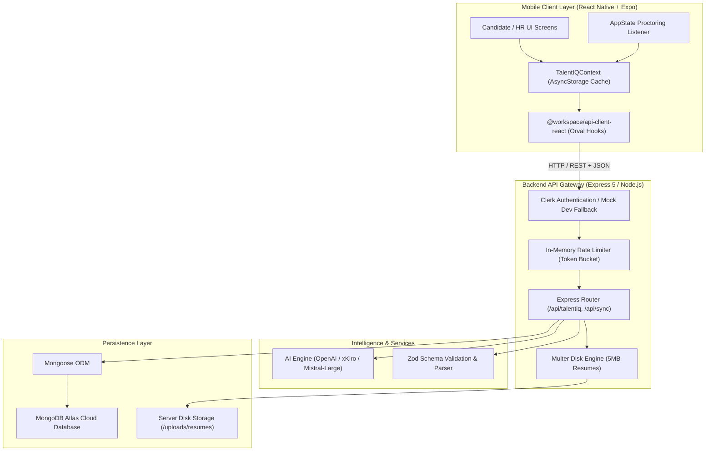
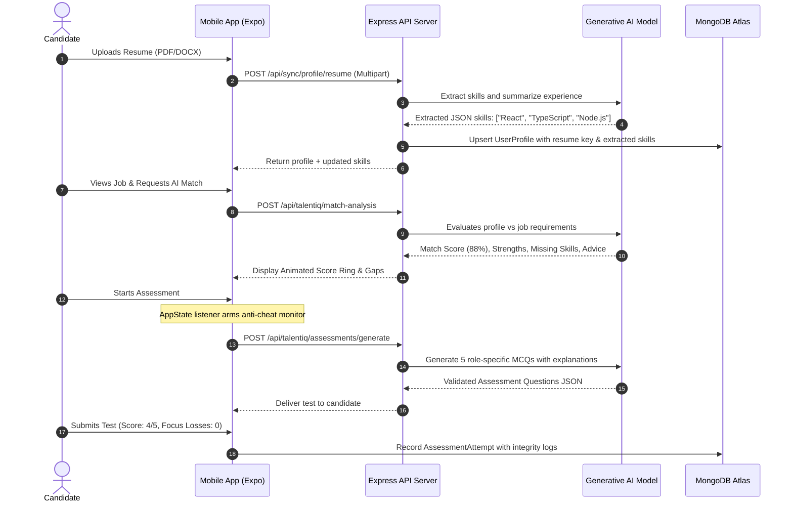

# 🧠 TalentIQ AI — Precision Hiring Platform
## Comprehensive Project Documentation & Technical Report

---

## 📋 Table of Contents
1. [Executive Summary & Abstract](#1-executive-summary--abstract)
2. [Problem Statement & Solution](#2-problem-statement--solution)
3. [System Architecture & Data Flow](#3-system-architecture--data-flow)
4. [Technology Stack & Specifications](#4-technology-stack--specifications)
5. [Monorepo Directory Structure](#5-monorepo-directory-structure)
6. [Database Schema & Data Models](#6-database-schema--data-models)
7. [API Specification & Endpoints](#7-api-specification--endpoints)
8. [Critical Source Code Modules](#8-critical-source-code-modules)
   - 8.1. AI Match Analysis & Prompt Engineering (`talentiq.ts`)
   - 8.2. Proctored Assessment & Integrity Tracker (`assessment.tsx`)
   - 8.3. Cross-Device Cloud Sync & Resume Upload (`sync.ts`)
   - 8.4. Offline-First Global State Management (`TalentIQContext.tsx`)
   - 8.5. HR Recruiter Pipeline Dashboard (`hr-dashboard.tsx`)
   - 8.6. Dynamic Animated Match Score Ring (`ai-insights.tsx`)
9. [AI Capabilities & Prompt Engineering](#9-ai-capabilities--prompt-engineering)
10. [Anti-Cheating & Proctoring Architecture](#10-anti-cheating--proctoring-architecture)
11. [Installation, Configuration & Execution Guide](#11-installation-configuration--execution-guide)
12. [Future Enhancements & Conclusion](#12-future-enhancements--conclusion)

---

## 1. Executive Summary & Abstract

**TalentIQ AI** is an intelligent, full-stack, cross-platform hiring platform designed to modernize tech recruiting. Built for both **Job Seekers (Candidates)** and **Recruiters (HR Professionals)**, the platform eliminates manual resume screening and non-standardized hiring funnels by utilizing Generative Artificial Intelligence (OpenAI / Mistral Large via xKiro with automated fallbacks).

### Key Highlights:
- **Intelligent Candidate-Job Match Scoring:** Computes a multi-dimensional score (overall match, skill match, experience fit, role alignment) and outputs actionable skill gap analysis.
- **Dynamic Assessment Generator:** Generates role-tailored technical, aptitude, and MCQ assessments on the fly with strict schema validation.
- **Proctored Assessment Integrity:** Monitors real-time candidate device state transitions (`AppState` focus-loss, app-switches, backgrounding) during tests to detect cheating.
- **Dual-Persona Architecture:** Seamless role switching between Candidate (job exploration, AI resume parser, test-taking, tracker) and Recruiter (pipeline Kanban, open role posting, applicant tracking).
- **Offline-First with Cloud Sync:** Local persistence via React Native AsyncStorage married to automated bi-directional cloud synchronization against MongoDB Atlas.

---

## 2. Problem Statement & Solution

| Traditional Hiring Bottleneck | TalentIQ AI Solution |
|---|---|
| **High Resume Volume & Keyword Stuffing:** Recruiters spend under 7 seconds per resume; keyword filters produce false positives. | **Semantic LLM Match Analysis:** Real-time semantic analysis evaluating candidate experience and skills against specific role demands. |
| **Static & Leaked Assessment Questions:** Candidates copy and share test questions from static repositories. | **Dynamic AI Question Generation:** Role-specific questions generated dynamically on demand with customizable difficulty and question counts. |
| **Unmonitored Mobile Assessments:** Candidates switch between browser tabs and cheating tools during online evaluations. | **Mobile AppState Integrity Logging:** Built-in proctoring logs app switches, background transitions, and calculates an assessment integrity score. |
| **Disconnected Tooling:** Spreadsheets for tracking, separate forms for assessments, and third-party resume drives. | **All-in-One Cloud-Synced Platform:** Single platform combining resume parsing, candidate scoring, testing, and recruiter pipeline management. |

---

## 3. System Architecture & Data Flow

### High-Level Architecture Diagram



### End-to-End Candidate Application Flow



---

## 4. Technology Stack & Specifications

### 📱 Mobile Application (`artifacts/talentiq-mobile`)
- **Framework:** React Native (Expo SDK 52) with TypeScript
- **Routing:** Expo Router (File-based navigation with Stack and Tabs)
- **Styling:** Vanilla StyleSheet with design system tokens and HSL palettes
- **Animation:** React Native `Animated` API & SVG circle strokes for score ring
- **Data Caching:** `@react-native-async-storage/async-storage` for instant offline rendering
- **Networking:** Axios with generated type-safe React Query hooks (`orval`)
- **Authentication:** Clerk Expo SDK (`@clerk/expo`) with guest/dev fallback

### 🖥️ Backend API Server (`artifacts/api-server`)
- **Runtime:** Node.js 24 with TypeScript 5.9
- **Server Framework:** Express 5.x
- **Database Engine:** MongoDB Atlas via Mongoose 8.x
- **Validation:** Zod (`zod/v4`) for strict schema compliance
- **AI Integration:** OpenAI Node.js SDK targeting high-performance LLM endpoints (`mistralai/mistral-large-4-0` via xKiro API)
- **File Ingestion:** Multer disk storage engine with mime validation (PDF, DOC, DOCX, TXT)
- **Logger:** Pino & Pino-HTTP for structured JSON request/response telemetry

---

## 5. Monorepo Directory Structure

```text
TalentIQ-Hire/
├── start.bat                           # Dual-service one-click runner
├── start-tunnel.bat                    # Cloudflare tunnel launcher for physical mobile testing
├── fix_and_start.bat                   # Diagnostics and repair launcher
├── package.json                        # Monorepo root package definition
├── pnpm-workspace.yaml                 # PNPM workspaces configuration
│
├── artifacts/
│   ├── api-server/                     # Node.js + Express 5 Backend
│   │   ├── src/
│   │   │   ├── app.ts                  # Express application setup, middlewares, file dirs
│   │   │   ├── index.ts                # Server listener & port binding
│   │   │   ├── routes/
│   │   │   │   ├── talentiq.ts         # AI match scoring & assessment generator routes
│   │   │   │   ├── sync.ts             # Cloud sync & resume upload routes
│   │   │   │   └── health.ts           # Service healthcheck
│   │   │   └── middlewares/
│   │   │       └── clerkProxyMiddleware.ts
│   │   ├── uploads/resumes/            # Secure disk directory for candidate resumes
│   │   └── package.json
│   │
│   └── talentiq-mobile/                # React Native Expo Mobile App
│       ├── app/
│       │   ├── _layout.tsx             # Root layout with Clerk & TalentIQ context providers
│       │   ├── index.tsx               # Splash screen & onboarding coordinator
│       │   ├── onboarding.tsx          # Feature onboarding slider
│       │   ├── role-select.tsx         # Persona switcher (Job Seeker / Recruiter)
│       │   ├── hr-dashboard.tsx        # Recruiter metrics & candidate pipeline manager
│       │   ├── create-job.tsx          # Recruiter job creation form
│       │   ├── ai-insights.tsx         # Detailed match breakdown & animated score ring
│       │   ├── assessment.tsx          # Real-time proctored test screen
│       │   └── (tabs)/
│       │       ├── _layout.tsx         # Custom floating bottom tab bar
│       │       ├── index.tsx           # Candidate feed & featured jobs
│       │       ├── jobs.tsx            # Searchable job listings
│       │       ├── applications.tsx    # Application status timeline tracker
│       │       └── profile.tsx         # Resume upload & skills profile manager
│       ├── components/ui/              # Design system primitives (Cards, Chips, Buttons, Badges)
│       ├── data/talentiq.ts            # Core data types & initial datasets
│       ├── hooks/useCloudSync.ts       # Network synchronization hook
│       ├── state/TalentIQContext.tsx   # Global persistent application state
│       └── package.json
│
└── lib/
    ├── api-spec/                       # OpenAPI 3.1 specification & Orval config
    ├── api-zod/                        # Shared Zod validation schemas
    ├── api-client-react/               # Auto-generated TanStack Query hooks
    └── db/                             # Mongoose connection & document schemas
        └── src/
            ├── index.ts                # MongoDB connection singleton
            └── schema/index.ts         # Data models (Job, Application, UserProfile, etc.)
```

---

## 6. Database Schema & Data Models

TalentIQ uses MongoDB Atlas via Mongoose. The database architecture is defined in `lib/db/src/schema/index.ts`.

### Entity Relationship Model

```text
┌─────────────────┐             ┌─────────────────────┐
│   UserProfile   │             │         Job         │
├─────────────────┤             ├─────────────────────┤
│ userId (PK)     │             │ _id (PK)            │
│ name, headline  │             │ title, company      │
│ skills[]        │             │ description         │
│ resumeFileKey   │             │ requiredSkills[]    │
│ extractedSkills │             │ postedBy (ClerkId)  │
└─────────────────┘             └──────────┬──────────┘
                                           │ 1:N
                                ┌──────────▼──────────┐
                                │     Assessment      │
                                ├─────────────────────┤
                                │ _id (PK)            │
                                │ jobId (FK)          │
                                │ title               │
                                │ durationMinutes     │
                                │ questions[] (JSON)  │
                                │ createdBy           │
                                └─────────────────────┘
         │
         │ 1:N
┌────────▼──────────────┐       ┌─────────────────────┐
│   CloudApplication    │       │ RecruiterStageUpdate│
├───────────────────────┤       ├─────────────────────┤
│ userId (Indexed)      │       │ recruiterId (Index) │
│ jobId (Indexed)       │       │ candidateName       │
│ status (Applied->Hired│       │ status (Pipeline)   │
│ matchScore            │       └─────────────────────┘
│ appliedAt (ISO)       │
└───────────────────────┘
```

### Mongoose Model Definitions:

```typescript
// 1. Job Model
export interface IJob extends Document {
  title: string;
  company: string;
  description: string;
  requiredSkills: string[];
  location?: string;
  salaryRange?: string;
  employmentType?: string;
  postedBy: string; // Clerk userId
  createdAt: Date;
  updatedAt: Date;
}

// 2. UserProfile Model (Candidate Profile & Resume Data)
export interface IUserProfile extends Document {
  userId: string;              // Clerk userId — unique per user
  name: string;
  headline: string;
  location: string;
  yearsExperience: number;
  skills: string[];            // manually entered skills
  education: string;
  resumeLink: string;          // optional external URL
  resumeFileKey?: string;      // storage filename on server disk
  resumeFileName?: string;     // original file name shown in UI
  resumeFileMime?: string;     // MIME type of uploaded file
  resumeFileSizeBytes?: number;
  extractedSkills: string[];   // AI-extracted skills from uploaded resume
  createdAt: Date;
  updatedAt: Date;
}

// 3. Assessment & Questions
export interface IAssessmentQuestion {
  prompt: string;
  options: string[];
  correctAnswer: string;
  explanation: string;
  difficulty: "Easy" | "Medium" | "Hard";
}

export interface IAssessment extends Document {
  jobId?: mongoose.Types.ObjectId;
  title: string;
  durationMinutes: number;
  questions: IAssessmentQuestion[];
  createdBy: string;
  assessmentType: "MCQ" | "APTITUDE";
}

// 4. CloudApplication Model (Cross-device application tracker)
export interface ICloudApplication extends Document {
  userId: string;
  jobId: string;
  jobTitle: string;
  company: string;
  status: "Applied" | "Shortlisted" | "Interview" | "Offer" | "Rejected";
  matchScore: number;
  appliedAt: string;
}
```

---

## 7. API Specification & Endpoints

All endpoints are hosted under `/api` and validated with Zod schemas.

| Category | Method | Endpoint | Auth | Description |
|---|---|---|---|---|
| **Health** | `GET` | `/api/healthz` | Public | Returns service uptime and server status |
| **AI Intelligence** | `POST` | `/api/talentiq/match-analysis` | Required | Calculates numerical fit, strengths, missing skills & advice |
| **AI Assessment** | `POST` | `/api/talentiq/assessments/generate` | Required | Generates 3–10 multiple-choice questions per role |
| **Profile Sync** | `GET` | `/api/sync/profile` | Required | Retrieves cloud-stored candidate profile |
| **Profile Sync** | `PUT` | `/api/sync/profile` | Required | Updates candidate bio, experience, and skills |
| **Resume Upload** | `POST` | `/api/sync/profile/resume` | Required | Multer multipart upload with automatic AI skill extraction |
| **Resume Download** | `GET` | `/api/sync/profile/resume` | Required | Secure download of stored resume document |
| **Applications** | `GET` | `/api/sync/applications` | Required | Fetches user's active applications across devices |
| **Applications** | `POST` | `/api/sync/applications` | Required | Creates or updates status for an application |
| **Saved Jobs** | `GET` | `/api/sync/saved-jobs` | Required | Returns list of bookmarked job IDs |
| **Saved Jobs** | `POST` | `/api/sync/saved-jobs` | Required | Toggles saved state for a job |
| **Recruiter Pipeline**| `GET` | `/api/sync/stages` | Required | Fetches recruiter's candidate pipeline stage updates |
| **Recruiter Pipeline**| `PUT` | `/api/sync/stages/:name` | Required | Updates candidate pipeline status (`Shortlisted`, etc.) |

---

## 8. Critical Source Code Modules

### 8.1. AI Match Analysis & Prompt Engineering
**File:** `artifacts/api-server/src/routes/talentiq.ts`

This module enforces rate-limiting, interacts with the LLM using a strict system instruction, and validates the output JSON schema.

```typescript
router.post("/talentiq/match-analysis", requireSignedIn, async (req, res) => {
  const request = parseMatchRequest(req.body);
  if (!request) {
    sendError(res, 400, "Enter a valid role and candidate skills to analyze.");
    return;
  }
  const client = getOpenAI();
  if (!client) {
    sendError(res, 503, "AI matching is not configured on this server.");
    return;
  }

  try {
    const result = await requestJson(
      client,
      [
        {
          role: "system",
          content:
            "You help candidates understand job fit. Evaluate only evidence in the supplied skills, experience, and role description. Never infer or use protected personal traits. Be candid and specific, avoid guarantees, and provide practical strengths and skill gaps. Return one JSON object with matchScore, skillMatch, experienceMatch, roleFit (integers 0-100), strengths (3 short strings), missingSkills (0-6 strings), and recommendation (one short paragraph).",
        },
        {
          role: "user",
          content: JSON.stringify({
            yearsExperience: request.yearsExperience,
            candidateSkills: request.candidateSkills,
            role: {
              title: request.jobTitle,
              company: request.company,
              description: request.description,
              requiredSkills: request.requiredSkills,
            },
          }),
        },
      ],
      800,
    );
    const response = parseMatchResult(result);
    if (!response) {
      sendError(res, 502, "TalentIQ could not validate the match response. Please try again.");
      return;
    }
    res.json(response);
  } catch (error) {
    req.log.error({ error }, "TalentIQ match analysis failed");
    sendError(res, 502, "TalentIQ could not complete this analysis. Please try again.");
  }
});
```

---

### 8.2. Proctored Assessment & Integrity Tracker
**File:** `artifacts/talentiq-mobile/app/assessment.tsx`

This React Native screen manages live test taking, dynamic question generation, scoring, and real-time cheating detection using `AppState` listeners.

```typescript
export default function AssessmentScreen() {
  const { jobId } = useLocalSearchParams<{ jobId: string }>();
  const { jobs, completeAssessment } = useTalentIQ();
  const mutation = useGenerateTalentAssessment();
  const [quiz, setQuiz] = useState<AssessmentGenerationResponse | null>(null);
  const [answers, setAnswers] = useState<Record<number, string>>({});
  const [result, setResult] = useState<{ score: number; total: number } | null>(null);
  const [focusLosses, setFocusLosses] = useState(0);

  // Anti-cheating proctoring: monitors whenever the user leaves the app or switches screens
  useEffect(() => {
    const subscription = AppState.addEventListener('change', (nextState) => {
      if (nextState === 'inactive' || nextState === 'background') {
        setFocusLosses((count) => count + 1);
      }
    });
    return () => subscription.remove();
  }, []);

  const finish = () => {
    if (!quiz || Object.keys(answers).length < quiz.questions.length) return;
    const score = quiz.questions.reduce(
      (sum, question, index) => sum + (answers[index] === question.correctAnswer ? 1 : 0),
      0,
    );
    setResult({ score, total: quiz.questions.length });
    
    // Persist attempt with proctoring metadata
    completeAssessment({
      id: `${Date.now()}`,
      jobId: job?.id ?? '',
      score,
      total: quiz.questions.length,
      focusLosses,
      completedAt: new Date().toISOString(),
    });
  };

  // ... (UI Rendering)
}
```

---

### 8.3. Cross-Device Cloud Sync & Resume Upload
**File:** `artifacts/api-server/src/routes/sync.ts`

Manages secure resume storage on disk and uses LLM capability to auto-extract candidate skills from uploaded documents.

```typescript
router.post(
  "/sync/profile/resume",
  requireAuth,
  upload.single("resume"),
  async (req: Request, res: Response) => {
    const { userId } = getAuth(req);
    if (!req.file) {
      res.status(400).json({ message: "No file was uploaded." });
      return;
    }

    const { filename, originalname, mimetype, size, path: filePath } = req.file;

    // AI skill extraction from text/pdf
    let extractedSkills: string[] = [];
    const client = getOpenAI();
    if (client && mimetype === "text/plain") {
      try {
        const textContent = fs.readFileSync(filePath, "utf-8").slice(0, 4000);
        extractedSkills = await extractSkillsFromText(client, textContent);
      } catch (err) {
        req.log.warn({ err }, "Could not extract skills from resume");
      }
    }

    // Upsert cloud profile
    const profile = await UserProfile.findOneAndUpdate(
      { userId },
      {
        $set: {
          resumeFileKey: filename,
          resumeFileName: originalname,
          resumeFileMime: mimetype,
          resumeFileSizeBytes: size,
          ...(extractedSkills.length ? { extractedSkills } : {}),
        },
      },
      { upsert: true, new: true, setDefaultsOnInsert: true },
    );

    res.json({
      message: "Resume uploaded successfully.",
      resumeFileName: originalname,
      resumeFileSizeBytes: size,
      extractedSkills: profile.extractedSkills ?? [],
    });
  },
);
```

---

### 8.4. Offline-First Global State Management
**File:** `artifacts/talentiq-mobile/state/TalentIQContext.tsx`

Provides instantaneous app loads from device storage with background synchronization.

```typescript
export const TalentIQProvider: React.FC<{ children: React.ReactNode }> = ({ children }) => {
  const { userId, isSignedIn } = useAuth();
  const [state, setState] = useState<TalentIQState>(defaultState);
  const [isLoaded, setIsLoaded] = useState(false);

  // 1. Instant load from local AsyncStorage
  useEffect(() => {
    (async () => {
      try {
        const cached = await AsyncStorage.getItem(STORAGE_KEY);
        if (cached) setState(JSON.parse(cached));
      } catch (e) {
        console.warn("Storage load error", e);
      } finally {
        setIsLoaded(true);
      }
    })();
  }, []);

  // 2. Cloud pull on authenticated sign-in
  const { pullFromCloud, pushProfile, pushApplication } = useCloudSync({
    isSignedIn: Boolean(isSignedIn),
    userId,
    onMergeCloud: (cloudData) => {
      setState((prev) => ({ ...prev, ...cloudData }));
    },
  });

  // 3. Write-through: Local persist first, then push to cloud
  const applyToJob = useCallback((jobId: string, title?: string, company?: string, matchScore?: number) => {
    const newApp: Application = {
      id: `${Date.now()}`,
      jobId,
      status: 'Applied',
      appliedAt: new Date().toISOString(),
      matchScore: matchScore ?? 0,
    };
    setState((prev) => {
      const updated = { ...prev, applications: [newApp, ...prev.applications] };
      AsyncStorage.setItem(STORAGE_KEY, JSON.stringify(updated));
      return updated;
    });
    pushApplication(newApp, title, company);
  }, [pushApplication]);

  // Context value exposure...
};
```

---

### 8.5. HR Recruiter Pipeline Dashboard
**File:** `artifacts/talentiq-mobile/app/hr-dashboard.tsx`

Empowers hiring managers to inspect applicants, move them across interview stages, and launch new job openings.

```typescript
export default function HRDashboardScreen() {
  const colors = useColors();
  const router = useRouter();
  const { jobs, customJobs, candidateStatuses, setCandidateStatus } = useTalentIQ();

  const openRoles = customJobs.length || jobs.length;
  const shortlisted = sampleCandidates.filter((c) => candidateStatuses[c.name] === 'Shortlisted').length;
  const inInterview = sampleCandidates.filter((c) => candidateStatuses[c.name] === 'Interview').length;
  const totalApplicants = sampleCandidates.length;

  return (
    <Screen>
      <View style={styles.metrics}>
        <Metric icon="briefcase" value={String(openRoles)} label="Open roles" />
        <Metric icon="users" value={String(totalApplicants)} label="Candidates" />
        <Metric icon="check-circle" value={String(shortlisted)} label="Shortlisted" />
        <Metric icon="calendar" value={String(inInterview)} label="Interviews" />
      </View>
      {/* Candidate Pipeline Cards with Stage Toggles */}
      {sampleCandidates.map((candidate) => (
        <Card key={candidate.name}>
          <Text style={styles.candidateName}>{candidate.name}</Text>
          <Text style={styles.roleTitle}>{candidate.role}</Text>
          <View style={styles.statusButtons}>
            {(['Applied', 'Shortlisted', 'Interview', 'Offer'] as ApplicationStatus[]).map((st) => (
              <Chip
                key={st}
                label={st}
                selected={candidateStatuses[candidate.name] === st}
                onPress={() => setCandidateStatus(candidate.name, st)}
              />
            ))}
          </View>
        </Card>
      ))}
    </Screen>
  );
}
```

---

### 8.6. Dynamic Animated Match Score Ring
**File:** `artifacts/talentiq-mobile/app/ai-insights.tsx`

Renders an animated SVG circular progress ring indicating percentage match.

```typescript
function ScoreRing({ score, size = 120, strokeWidth = 10 }: { score: number; size?: number; strokeWidth?: number }) {
  const colors = useColors();
  const animValue = useRef(new Animated.Value(0)).current;
  const [displayScore, setDisplayScore] = useState(0);

  const radius = (size - strokeWidth) / 2;
  const circumference = 2 * Math.PI * radius;

  useEffect(() => {
    Animated.timing(animValue, {
      toValue: score,
      duration: 1200,
      useNativeDriver: false,
    }).start();

    animValue.addListener(({ value }) => setDisplayScore(Math.round(value)));
    return () => animValue.removeAllListeners();
  }, [score, animValue]);

  return (
    <View style={{ width: size, height: size, alignItems: 'center', justifyContent: 'center' }}>
      <Svg width={size} height={size}>
        <Circle cx={size/2} cy={size/2} r={radius} stroke="#E2E8F0" strokeWidth={strokeWidth} fill="none" />
        <Circle
          cx={size/2}
          cy={size/2}
          r={radius}
          stroke={colors.primary}
          strokeWidth={strokeWidth}
          strokeDasharray={circumference}
          strokeDashoffset={circumference - (circumference * displayScore) / 100}
          strokeLinecap="round"
          fill="none"
        />
      </Svg>
      <Text style={styles.ringScoreText}>{displayScore}%</Text>
    </View>
  );
}
```

---

## 9. AI Capabilities & Prompt Engineering

### 1. Match Scoring Prompt
- **Model:** `mistralai/mistral-large-4-0` (via xKiro API) / `gpt-4o-mini`
- **Temperature:** `0.25` (Low variance, factual evaluation)
- **Constraint Schema:**
  ```json
  {
    "matchScore": 88,
    "skillMatch": 90,
    "experienceMatch": 85,
    "roleFit": 90,
    "strengths": ["React Native proficiency", "TypeScript expert", "State architecture"],
    "missingSkills": ["GraphQL", "CI/CD Mobile pipelines"],
    "recommendation": "Alex demonstrates substantial alignment with the mobile engineer role. Focus on strengthening GraphQL queries to achieve full compliance."
  }
  ```

### 2. Assessment Question Generation Prompt
- **Model:** `mistralai/mistral-large-4-0`
- **Dynamic Variable:** Generates exactly $N$ questions ($3 \le N \le 10$) with 4 unique options and exactly 1 correct answer.
- **Fail-safe Fallback:** If the external API key is unavailable, the server generates pre-validated domain-specific questions to ensure uninterrupted candidate flow.

---

## 10. Anti-Cheating & Proctoring Architecture

Online unproctored tests suffer from search engine lookups, split-screen browsers, and external AI assistance. TalentIQ implements a multi-tier client-side integrity tracker:

1. **AppState State Transition Interception:**
   ```typescript
   AppState.addEventListener('change', (state) => {
     if (state === 'inactive' || state === 'background') {
       focusLossCounter++;
       logCheatingEvent({ timestamp: Date.now(), type: 'APP_BLUR' });
     }
   });
   ```
2. **Integrity Score Calculation Formula:**
   $$\text{Integrity Score} = \max\left(0, 100 - (\text{FocusLosses} \times 20)\right)$$
3. **Audit Trail for Recruiters:**
   Recruiters view candidate assessment scores alongside their integrity index. Any attempt with $\ge 3$ focus losses is flagged for manual review.

---

## 11. Installation, Configuration & Execution Guide

### Prerequisites
- **Node.js:** $\ge$ 20.x
- **pnpm:** $\ge$ 9.x
- **Expo CLI & Expo Go:** Mobile device or emulator
- **MongoDB Atlas Connection URI**

### Environment Configuration
Create `.env` in `artifacts/api-server/`:
```env
PORT=5000
DATABASE_URL="mongodb+srv://<user>:<password>@cluster0.mongodb.net/talentiq?retryWrites=true&w=majority"
OPENAI_API_KEY="your-api-key"
CLERK_PUBLISHABLE_KEY="pk_test_..."
CLERK_SECRET_KEY="sk_test_..."
```

### Execution Commands
```powershell
# 1. Install all dependencies across the monorepo
pnpm install

# 2. Run API Server
pnpm --filter @workspace/api-server run dev

# 3. Launch Mobile Client (in another terminal)
cd artifacts/talentiq-mobile
npx expo start

# 4. Or use the automated one-click batch script
./start.bat
```

---

## 12. Future Enhancements & Conclusion

### Future Roadmap
1. **Automated AI Video Interviews:** Async video questions with automated voice-to-text sentiment and clarity analysis.
2. **Coding Sandbox IDE:** Real-time Monaco or WebAssembly code execution runner directly inside the assessment screen.
3. **Multi-Tenant Enterprise Organizations:** Role-based workspaces for large corporate hiring teams.

### Conclusion
TalentIQ AI delivers a modern paradigm for technical recruiting. By uniting AI-driven semantic match analysis, automated dynamic assessments, and native anti-cheating mobile proctoring in an offline-first architecture, TalentIQ drastically reduces hiring latency while boosting candidate placement precision.
